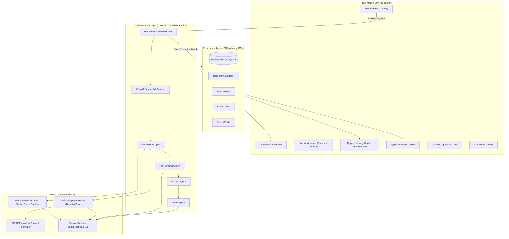
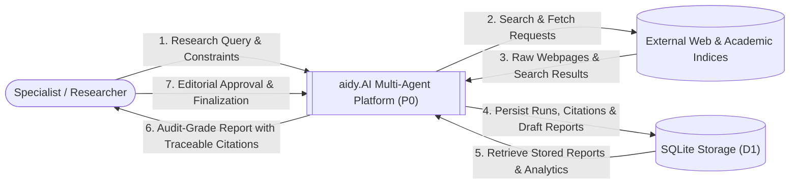
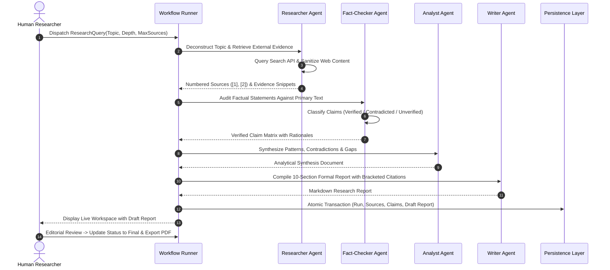
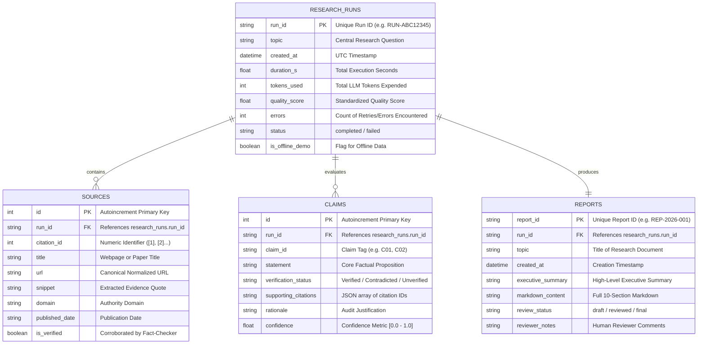

# aidy.AI System Architecture & Design Documentation

## 1. System Overview
**aidy.AI** is an autonomous multi-agent intelligence platform engineered to execute end-to-end research, source grounding, claim verification, and formal reporting. The architecture adheres to a clean layered design separating user interaction, multi-agent orchestration, external tool gateways, and persistence.

---

## 2. System Block Diagram

---

## 3. Data Flow Diagram (DFD Level 0 — Context Level)

---

## 4. Multi-Agent Sequential Workflow

The orchestrated execution progresses through a deterministic, fail-safe 7-stage pipeline:

---

## 5. Entity-Relationship (Data Model) Diagram

---

## 6. Component Explanations

1. **ResearchWorkflowRunner (`src/aidy/crew/workflow.py`):** Central coordinator controlling execution budgets, event callbacks to the UI, deterministic fallback triggers, and multi-agent task handoffs.
2. **SourceRegistry (`src/aidy/tools/source_registry.py`):** Thread-safe in-memory registry enforcing URL normalization, deduplication, and sequential citation numbering (`[1]`, `[2]`, ...).
3. **Security Firewall (`src/aidy/core/security.py`):** Protects the host system against SSRF by disallowing localhost, RFC 1918 private ranges, and cloud metadata endpoints. Defuses prompt-injection strings inside external HTML.
4. **Report Exporters (`src/aidy/export/`):** Converts structured Pydantic report schemas into clean Markdown and styled ReportLab PDFs in the aidy.AI brand palette.
5. **Database Repositories (`src/aidy/persistence/`):** Implements the Repository Pattern via SQLAlchemy ORM, decoupling database access from business logic.
